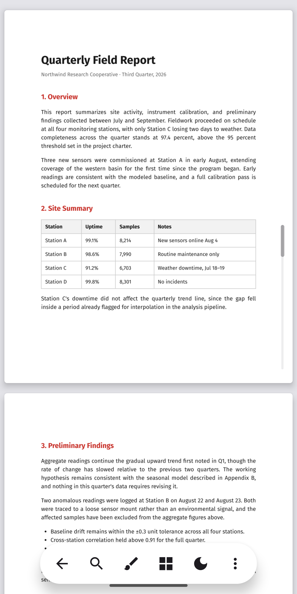
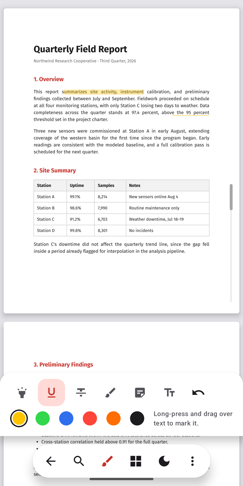
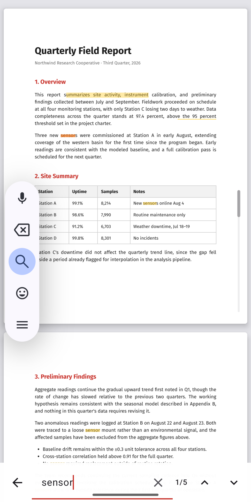
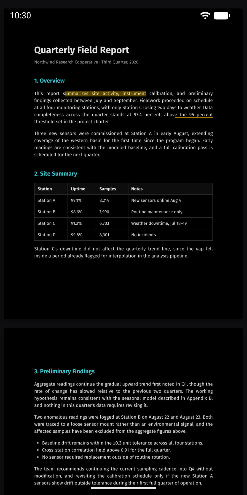

# Pdfrid — Offline Pdf Reader

A small PDF reader in the spirit of Preview on macOS and the iOS document viewer: open a file,
scroll, pinch, done. No sign-in, no cloud, no ads.

It **declares no Android permissions at all**. Documents arrive as content URIs that you picked
in the system file picker or shared from another app. Rendering and text extraction go through
`androidx.pdf`, which does the work in an **isolated process** — a malformed or hostile PDF
cannot take the app down with it, let alone reach your data.

<p>
  
  
  
  
</p>

## Why I made this

I just wanted to open a PDF and read it. Most PDF apps on the Play Store come with ads,
accounts, cloud upsells and a pile of permissions they don't need. So I built the one I use
myself: it opens files, lets me search, highlight and share, and does nothing else. No ads, no
tracking, no permissions. It only has the features I actually use.

## Features

- **Full-text search** across the document, with every match highlighted, the current one
  picked out in a stronger colour, and next/previous stepping that scrolls to each hit.
- **Text selection and copy** — long-press a word to select it, then drag either round grip to
  adjust the selection after lifting your finger. The selection bar echoes the text and offers
  Copy, Select page, Find (searches the document for it) and Share. "Copy text on this page" in
  the overflow menu grabs a whole page at once.
- **Annotation** — highlight, underline and strikethrough by dragging over text, a freehand
  brush, and pinned notes you can tap to reread. Six ink colours, undo, and a list of every mark
  in the document that jumps to it. Marks are stored beside the app's data, keyed by document,
  and survive closing the app.
- **Add text** — tap the page and type; the words go on at the ink colour you picked and are
  burned into the exported copy.
- **Export annotated copy** — writes a flattened PDF with the marks burned in and hands it to
  the share sheet. The original file is never modified.
- **Split and merge**, done properly: page objects are copied rather than re-rendered, so text,
  fonts and vector art survive. Split takes ranges like `1-3, 5, 8-10`, or one file per page.
- **Password-protected documents** open once you enter the password.
- **Continuous vertical scrolling** across the whole document, with pages rendered on demand
  and cached, so a 500-page file opens as fast as a one-pager.
- **Pinch to zoom** up to 6x with panning, and double-tap to toggle 2.5x. Pages re-render at the
  zoomed resolution rather than being scaled up, so text stays sharp.
- **Tap to hide the chrome** — the toolbars slide away and the page fills the screen.
- **Thumbnail grid** for jumping around, plus a page slider at the bottom.
- **Night mode** that inverts the page, for reading in the dark.
- **Rotate** in 90° steps.
- **Share and print** through the system, passing the original bytes along untouched.
- **Recents** with the page you stopped on, so reopening a document returns you to your place.
- **Opens from other apps** — it registers for `VIEW` and `SEND` on `application/pdf`, so it
  shows up in "Open with" from a files app, a browser or an email client.

## What it deliberately does not do

No image conversion, scanning, form filling or page reordering — this stays a reader with two
file tools, not a PDF suite. Annotations are kept alongside the app's data rather than
written into the PDF: the file you opened is a content URI the app may not be allowed to modify,
and silently rewriting someone's document is not a reader's job — "Export annotated copy" is how
marks leave the app, and the copy is flat, so its text is no longer selectable.

Search matches literal text, so
it will not find words split across a line break or stored as scanned images with no text layer
(OCR is a separate `androidx.pdf` module this app does not pull in).

## Why minSdk 28

Search and selection need text out of the PDF, and the platform's own `PdfRenderer` only gained
those APIs in Android 15 (`getTextContents`, `searchText`, `selectContent` are all `since=35`).
Relying on those directly would have left the feature broken on almost every device in use, so
the app uses `androidx.pdf`, which backports them to API 28. That is the whole reason the floor
moved from 26 to 28; it costs Android 8.0 and 8.1.

One packaging note: `pdf-document-service` declares a dependency on the entire `pdf-viewer` UI
library while referencing none of its classes, which would drag Material Components,
RecyclerView and Fragment into a Compose-only app. `app/build.gradle.kts` excludes it.

## Building

Requires JDK 17+ and the Android SDK (compileSdk 36). Open this folder as the project root in
Android Studio, or use the wrapper script, which finds Studio's bundled JDK and your SDK on its
own and writes `local.properties` for you:

```
./build.sh              # debug APK -> app/build/outputs/apk/debug/app-debug.apk
./build.sh test         # unit tests
./build.sh install      # build and adb install to the connected device
./build.sh release      # unsigned release APK, ~3 MB
./build.sh lint
./build.sh all
./build.sh clean
```

## Layout

| Path | What lives there |
|---|---|
| `pdf/PdfSession.kt` | Opens a URI; renders pages, searches text, resolves selections. |
| `pdf/PageTransform.kt` | Rotate-translate-scale geometry, and the page↔screen coordinate mapping used to place highlights. Free of Android types so it is unit-tested. |
| `pdf/PageCache.kt` | `LruCache` of rendered pages, sized to a quarter of the heap. |
| `data/Recents.kt` | Recents list and last-read page, as JSON in SharedPreferences. |
| `ui/ViewerScreen.kt` | Scrolling, zoom gestures, chrome, search bar, thumbnails. |
| `ui/DocumentActions.kt` | Share, and a print adapter that copies the file to the spooler. |
| `build.sh` | Toolchain-detecting build wrapper; see above. |

## Testing

PDF rendering is native code with no JVM stub, so the render path itself cannot run in a unit
test. What is covered is the logic that silently breaks:

- the rotation transform, verified by mapping the page's four corners onto the bitmap rectangle
  at every rotation;
- the page↔screen coordinate mapping that positions search highlights and selection boxes,
  including that `fractionToPage` is a true inverse of the forward mapping at every rotation —
  get this wrong and highlights land on the wrong words;
- the recents serialisation, including malformed data left by an older version.

Sixteen tests in all.
